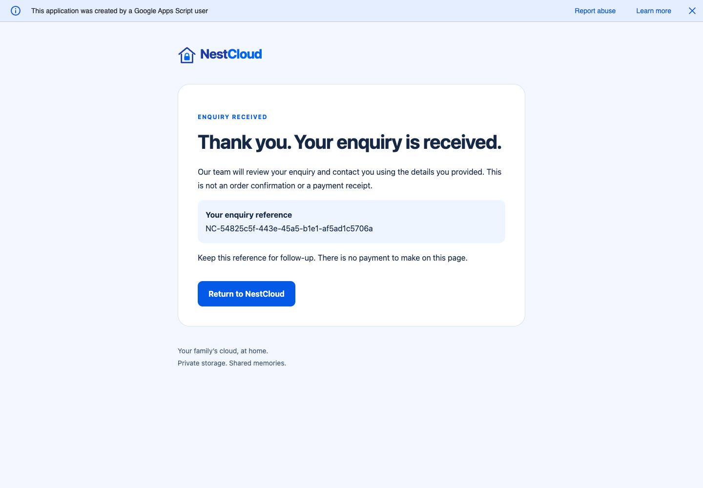
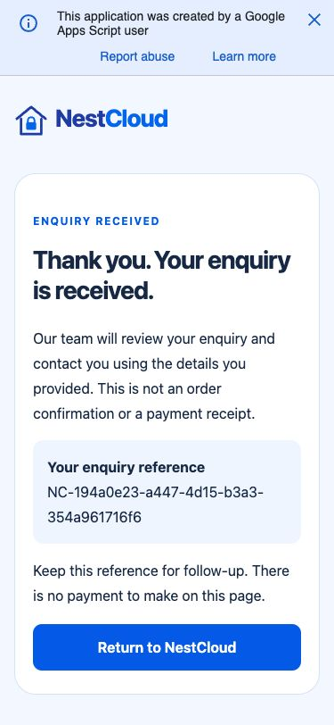
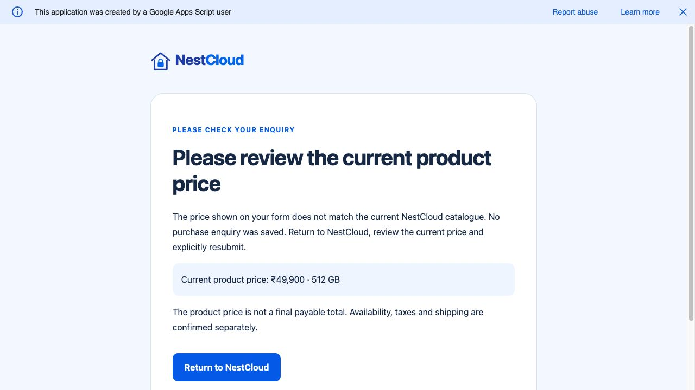

# Phase 5B — controlled live verification

Verified 3 November 2026 against backend PR #3 (`a6e88e3`, runtime source unchanged) and frontend PR #4 (`84240b4`). This report and the backend setup-guide correction are follow-up documentation only. PRs remain unmerged. No website publication, DNS, production configuration, or production form changes occurred.

## Environment and evidence standard

- Separate private Google Sheet and standalone Apps Script project: `NestCloud Enquiries - TEST`, owned by the account selected by the owner.
- Web App version 1: execute as owner, access Anyone. The temporary setup wrapper was removed before deployment; `Code.gs` was compared with the reviewed source and matched exactly.
- Local PR #4 frontend on `127.0.0.1:5175`, with process-only test endpoint and `enquiry-test-v1` consent version. No endpoint, spreadsheet ID, credential or production variable is committed here.
- Only synthetic names, `example.invalid` email addresses, dummy mobile `9000000000`, and explicitly marked test messages were submitted. No email/SMS service is implemented by this backend.
- PASS means an actual live Google result and, for acceptance/rejection, independent observation of the corresponding Sheet row or absence of the test ID. MOCK means automated tests only. BLOCKED means required manual/environment coverage remains. FAIL means a reproduced defect, even if subsequently fixed.

## Live results

| Scenario | Result | Independently observed evidence |
| --- | --- | --- |
| Purchase: 512 GB | PASS | Purchase Enquiries row, `512gb`, INR 49900; matching receipt `NC-54825c5f-443e-45a5-b1e1-af5ad1c5706a`. |
| Purchase: 1 TB | PASS | Purchase Enquiries row, `1tb`, INR 59900, 1 TB personal storage; matching receipt `NC-6d939914-7a85-4c6e-86de-1a0687765eb0`. |
| Purchase: Backup Plus | PASS | Purchase Enquiries row, `backup`, INR 81900, 1 TB personal plus separate 1 TB backup SSD; matching receipt `NC-194a0e23-a447-4d15-b3a3-354a961716f6`. |
| General Contact | PASS | General Contact row, correct type/details, no purchase fields; receipt `NC-ca35d65a-68d8-402a-8fff-9e70006cd4c5`. |
| Technical Support | PASS | Technical Support row, order `TEST-ORDER-0001`, serial `TEST-SERIAL-0001`, category `backup`, no purchase fields; receipt `NC-6c56777a-9e0b-4f11-ae89-d9c11a57148a`. |
| Same-ID browser retry | PASS | Browser Back restored details; unchanged resend displayed already-received confirmation, original receipt, and still one row for the original ID. |
| Intentional detail change | PASS | Changed email/message produced a distinct UUID and receipt; second 512 GB row, not an overwrite. |
| Server-derived prices / mismatch | PASS | Direct native test POST supplied 49901 for 512 GB; Google rejected it and displayed catalogue price 49900. No row with that test ID. Accepted row prices matched the server catalogue. |
| Invalid PIN / missing consent at backend | PASS | A localhost-only native HTML harness bypassed frontend checks. Google rejected a zero-leading PIN and empty consent; neither ID appeared in the Sheet. Harness removed afterward. |
| Invalid email / missing consent at frontend | PASS | Real browser displayed inline errors without navigation. General Contact had zero rows after those attempts; corrected form subsequently saved. |
| Google-hosted confirmation | PASS | Actual Google sandbox rendered branded receipt/error pages. Confirmation displayed no submitted name, email, phone, message, Sheet ID or stack trace. |
| Return-to-NestCloud | PASS | Clicked the actual confirmation link; navigated to `https://nestcloud.in/`. Read-only visit, no production form submission. This intentionally does not return to localhost. |
| Desktop and mobile-width browser | PASS | Real native Google POST and confirmation at 1440px and 375px widths. Mobile purchase document width 360px within 375px viewport; screenshots below. This is responsive emulation, not physical-device certification. |
| Private Sheet access | PASS | Google sharing dialog showed Restricted, with exactly the owner in the access list. No public/link sharing enabled. |
| Disabled submissions / recovery | PASS | `ALLOW_SUBMISSIONS=false` produced could-not-confirm, no row for the test ID. Restoring true and retrying unchanged saved exactly one row, receipt `NC-a3fa8db6-ff26-4f39-ac06-ca0a936c4432`. |
| Unavailable Sheet / recovery | PASS | Temporarily replaced only the TEST Sheet property with a nonexistent synthetic reference, restoring it in a finally block. Failure produced no success or saved row. Same-ID retry after restoration saved exactly one row, receipt `NC-08b3fadb-e711-4f70-9b6c-c86f3ab90b4b`. |
| Simultaneous anonymous same-ID POST | PASS | Two cookie-free requests returned original/already-received outcomes with identical receipt `NC-fc411910-9599-417f-acfe-9b7b682b0b16`. Sheet independently contained one row for their shared ID. |
| Partial-write/flush ambiguity, malformed metadata, storage denial, expiry and additional validation boundaries | MOCK | Covered by the automated suite, not by deliberately corrupting live Sheet data or exhausting Google quotas. |
| Physical iOS/Android and other browser engines | BLOCKED | Only the available browser and responsive viewport emulation were exercised. Owner/device testing remains. |

Final independently observed totals: **4 Purchase, 4 General, 1 Support = 9 synthetic rows**, each with a unique submission ID and receipt. Rejected IDs were absent. Recovery and duplicate claims were not inferred from HTTP 200 alone.

## Reproduced defect and correction

**FAIL, corrected in backend PR #3 documentation:** the original setup guide instructed users to select the underscore-suffixed `setupEnquirySheets_` directly. The real Google editor only listed public functions. A temporary undeployed editor wrapper successfully invoked the existing helper; it was removed before Web App deployment. The guide now documents that workflow and the account-wide Sheets permission scope. No backend or frontend runtime change was required by these tests.

**Platform limitation:** a direct GET in the multi-account signed-in browser redirected to an account-specific Google error page. A cookie-free GET returned the correct informational page, and native browser POSTs plus anonymous POSTs succeeded. Do not treat that multi-account GET error as proof that a POST failed or automatically generate a new ID.

## Screenshots

## Validation

- Frontend PR #4 complete suite: **137 passed**, zero failed. Standalone `tsc --noEmit`, build and 17-page export verification passed.
- Backend PR #3 complete branch suite: **83 passed**, zero failed. Standalone TypeScript, build and 15-page export verification passed.
- GitHub `validate` was successful on both reviewed heads. Follow-up documentation commits must also pass their new validation runs before review approval.
- No deployment workflow was invoked. GitHub Pages remains unchanged.

## Final state, rollback and remaining risks

The correct private Sheet property and consent version are restored. **ALLOW_SUBMISSIONS is false** after testing. The TEST Web App remains deployed but does not accept enquiries. Synthetic evidence rows are retained for owner inspection. Submitted drafts may remain in the local test browser's tab-scoped session storage until explicitly cleared or expiry; no real customer details were entered.

To roll back or close testing:

1. Keep `ALLOW_SUBMISSIONS=false` in this TEST project. This disables new enquiries and receipt retries without deleting rows or changing production.
2. To withdraw the endpoint entirely, use TEST project Deploy → Manage deployments → select the test deployment → Archive. Do not alter another project/deployment.
3. Stop the localhost preview, close its tabs, and use Clear details & start a new enquiry if continuing in the same tab. Do not copy staging variables into repository Actions settings.
4. Preserve test rows while reviewing retries. Deleting saved rows removes their idempotency history; no automatic row deletion or production rollback was performed.
5. To revert the documentation-only Git changes, revert their commits on the relevant PR branches; do not roll back runtime images or customer data.

**Production recommendation: NO-GO for publication yet.** The controlled staging delivery paths passed, but physical-device/cross-browser acceptance and owner approval of consent wording, staff access, retention/deletion and abuse/quota handling remain. Account-wide authorization, Google platform banners/multi-account behavior, quota outages and modest-volume limits remain material constraints. Do not infer production readiness or guaranteed delivery from these staging results. No merge or production deployment is authorized by this report.
